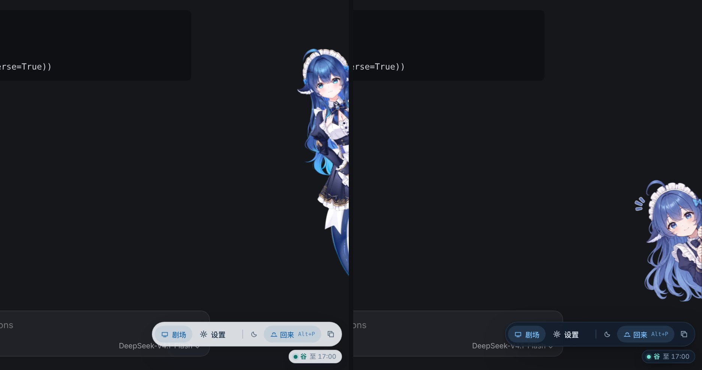
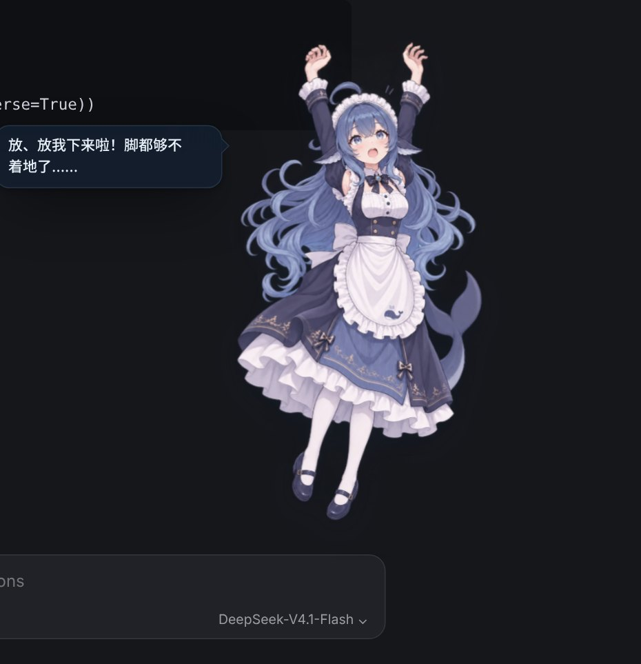

<a id="top"></a>
# 大肥鱼 — dsh-whale-pet

[中文说明](#chinese) | [English](#english) | [操作说明](docs/USER_GUIDE.zh-CN.md) | [User guide](docs/USER_GUIDE.md) | [使用截图 / Screenshots](#screenshots) | [Releases / 下载](https://github.com/Ewigkeit1203/dsh-whale-pet/releases) | [更新日志 / Changelog](CHANGELOG.md) | [文档 / Docs](docs/README.md)

<a id="screenshots"></a>
## 使用截图 / Screenshots

**她就住在 DSH 里。** 导入可选的 Live2D 模型后，她会用眼睛和头跟着鼠标看，呼吸、发呆、自己找点事做。头顶常显梁文峰 / 梁文谷时段和账户余额，时段切换时她会换个表情告诉你；鼠标移到她身上，上方弹出剧场、设置、安静模式、探头等快捷操作。没有模型时显示原版插图。
**She lives inside DSH.** With the optional Live2D model imported she follows the pointer with her eyes and head, breathes, idles and keeps herself busy. Chips above her head always show the DeepSeek pricing period (梁文峰 = peak, 梁文谷 = off-peak) and your balance, and she announces each period switch with a new expression; hover over her for quick actions (Theatre, Settings, Quiet mode, Peek). Without the model, the original illustrations are shown.<br>


<table>
  <tr>
    <td width="50%"></td>
    <td width="50%"></td>
  </tr>
  <tr>
    <td>设置面板贴在她身旁，不会挡住她：余额卡片、计费时段，以及到几点结束。<br>Settings sit beside her, never on top: balance, pricing period and when it ends.</td>
    <td>浅色主题，周末全天梁文谷（半价）。主题只影响插件本身。<br>Light theme; weekends are off-peak all day. Themes affect only the companion.</td>
  </tr>
</table>

**GalGame 对话剧场：** 点击输入框即可进入。全屏场景、居中的立绘、深蓝毛玻璃对话框和名字标签；她的表情会随每一页台词变化，头顶冒出情绪符号；文字逐字淡入，可以快进，代码有专门的卡片。<br>
**Visual-novel theatre:** click the chat box to enter. A full-screen scene, a centred portrait and a deep-blue glass dialogue box with a name tag; her expression changes with each page, with a mood mark above her head; text fades in character by character, with Skip, and code gets copyable cards.


**四套背景，也能用你自己的图：** 和室书房·夜、科技机房、午后咖啡厅、海边黄昏，默认跟随时间切换，切换时 0.7 秒交叉淡入；也可以保留「透明」显示 DSH。<br>
**Four backgrounds, or your own picture:** a study at night, a server room, an afternoon café and a seaside dusk, following the time of day by default, with a 0.7 s crossfade; “Transparent” keeps DSH visible.


**背景音乐与背景切换：** 左上角的小按钮打开音乐、背景和剧场设置。三首内置曲目「日常轻快 / 宁静闲聊 / 深夜治愈」由插件实时演奏、无缝循环，也可以添加本地音乐；音量和选择会自动记住。<br>
**Music and backgrounds:** the chips at the top left open music, backgrounds and theatre settings. Three built-in tracks (Everyday Breeze, Quiet Chat, Late-night Comfort) are performed live and loop seamlessly, or add your own file; volume and choices are remembered.


**六个新表情：** 得意、害羞、抓狂、惊讶、满足、开心，剧场和日常互动都会用到。<br>
**Six new expressions:** smug, shy, frustrated, surprised, proud and happy, used in the theatre and in everyday moments.


<table>
  <tr>
    <td width="33%"></td>
    <td width="33%"></td>
    <td width="33%"></td>
  </tr>
  <tr>
    <td>在她头上来回移动鼠标：摸摸头，她会一脸满足或害羞，并叫出你设置的称呼。<br>Move the pointer over her head for a head pat; she looks content or shy and uses the name you set.</td>
    <td>Live2D：在尾巴上来回摸，她会害羞地躲开；一直摸会生气。<br>Live2D: stroke her tail and she blushes and dodges; keep at it and she gets cross.</td>
    <td>拖动她就被拎起来：先扑腾，再垂下来跟着手摆，松手落地。拖着快速晃会头晕；一直戳她是小彩蛋。<br>Dragging picks her up: she struggles, then dangles and swings; let go and she lands. Shake her and she gets dizzy; keep poking her for an easter egg.</td>
  </tr>
</table>

**从右边探头陪你：** 点悬停菜单里的「探头」或按 **Alt+P**（可在设置里改），她会躲到窗口右边，只探出半个身子，不挡住对话；再按一次就回到原来的位置。Live2D 模型会斜着探出来、一只手拉住边框；没有模型时有专门的探头插图。<br>
**Peeking from the right edge:** choose Peek in the hover menu or press **Alt+P** (change it in Settings) and she hides behind the right edge of the window, half out of sight and clear of the conversation; press again to bring her back to her spot. The Live2D model leans out holding the edge; without the model a dedicated peeking illustration is used.



<table>
  <tr>
    <td width="40%"></td>
    <td>没有 Live2D 模型时，拎起来也有专门的插图：双手举高、脚够不着地。<br>Without the Live2D model, being picked up has its own illustration too: arms up, feet off the ground.</td>
  </tr>
</table>

<details>
<summary>代码卡片与回答结束后的干饭时间 / Code card and rice break after the answer</summary>


</details>

<sub>截图使用模拟的 DSH 页面和演示余额，插件界面是真实的 v0.8.0 代码；人物为可选导入的 DeepSeek-chan（大肥鱼）Live2D 模型（原画及拆分 [神宫凉子](https://space.bilibili.com/13737731)，Live2D 建模 霓虹猫_NeonNeko），模型不随插件提供。表情、场景与代码页截图来自 v0.6.0 的插图模式。 / Screenshots use a simulated DSH page and sample balance; the plugin UI is the actual v0.8.0 build. The character is the optionally imported DeepSeek-chan (大肥鱼) Live2D model (art and parts by [神宫凉子](https://space.bilibili.com/13737731), rigging by 霓虹猫_NeonNeko), which is not included with the plugin. The expression, scene and code-page screenshots come from v0.6.0 with illustrations.</sub>

<a id="chinese"></a>
## 中文说明

**非官方社区插件，与 DeepSeek 官方无隶属或背书关系。**

大肥鱼是专为官方 [DeepSeek Harness (DSH)](https://github.com/deepseek-ai/deepseek-harness) 开发的桌宠与 GalGame 对话剧场。她生活在 DSH 界面内，会随着思考与回答切换动作，陪你一起工作。

中英文统一使用产品名 **大肥鱼**；仓库与包标识继续使用 `dsh-whale-pet`。

**👉 [操作说明](docs/USER_GUIDE.zh-CN.md)**：安装、互动、探头、剧场、Live2D 导入、设置和快捷键都在这里。

### 最新版本：v0.8.1

- **余额与提醒：** 五种明确的余额状态、详情与刷新/重试入口、可配置头顶标签和每日低余额提醒。后台完成回答后可标记标题，回来时提醒一次，也可关闭。
- **上手与导入：** 三步引导移到角色身旁，新增本机互动图鉴；Live2D 导入卡提供获取链接、进度和文件夹拖放。
- **安装目录整理：** 只需双击根目录 install.bat 或 uninstall.bat；必需的 PowerShell 辅助脚本放在 installer/，请保留该文件夹。启动器仍兼容旧版根目录脚本布局。
- 修复账户切换串余额、正常回答错误码误报、异常图鉴日期、提醒关闭后残留，以及摸尾巴触发戳人生气的问题。

完整说明见 [v0.8.1 发布说明](docs/releases/v0.8.1.md)。更早版本的更新内容请看[更新日志](CHANGELOG.md#chinese)。

### 安装或升级

1. 从 [Releases](https://github.com/Ewigkeit1203/dsh-whale-pet/releases) 下载 **dsh-whale-pet-v0.8.1.zip**。
2. 完整解压到固定文件夹，例如 `D:\dsh-whale-pet`。
3. 双击 `install.bat`，再打开 DSH，或在已打开的窗口中按 **Ctrl + R** 刷新。
4. 升级时覆盖同一目录中的插件文件；若换了目录，请重新运行安装脚本。解压后的文件需要保留。

卸载时运行 `uninstall.bat` 并刷新 DSH，已保存的本地偏好会保留。React 与 Cordis 由 DSH 提供，普通用户无需 Node.js、npm 或额外素材。旧版 v0.1.0–v0.6.0 的安装脚本在 Windows 上可能失败，见[安装问题与旧版本修复](docs/INSTALLATION_RECOVERY.md)。

<details>
<summary>手动安装</summary>

在 `~/.dsh/profiles/desktop/cordis.patch.yml` 追加以下内容，替换为实际路径：

```yaml
- insert:
    - id: dsh-whale-pet
      name: "file:///D:/dsh-whale-pet/lib/index.js"
```

</details>

### 快速上手

- **鼠标悬停**在她身上出现快捷菜单：剧场、设置、安静模式、探头。
- **点击**她打开设置，**拖动**把她拎起来，在头上来回移动鼠标**摸头**。
- **Alt+P** 让她躲到右边探头，**Alt+T** 开关剧场，**Alt+W** 隐藏她。
- 点击 DSH 聊天输入框进入 **GalGame 剧场**，按 Esc 离开。
- 可选导入免费的 **Live2D 模型**（插件不附带，[导入步骤](docs/USER_GUIDE.zh-CN.md#live2d-模型可选)）。

更多操作见 **[操作说明](docs/USER_GUIDE.zh-CN.md)**。

### 兼容性与隐私

偏好、你添加的剧场图片和音乐、导入的 Live2D 模型都只保存在本机，不会上传。聊天记录不会被保存，也不会发送给任何额外服务。余额通过 DSH 自带的账户服务读取，需要登录 DeepSeek 账号，插件不接触任何凭据。计费时段按 [DeepSeek 官方规则](https://api-docs.deepseek.com/zh-cn/quick_start/pricing/)，节假日表目前覆盖 2026 年。回答识别依赖 DSH 页面结构。

### 本地开发

运行 TypeScript 测试建议使用 Node.js 22.18+ 或 24+。通过 `pnpm install` 安装开发依赖，然后执行：

```sh
npm run build
npm run typecheck
npm test
node --check lib/client.js
```

构建会把界面、状态机、宿主适配器、CSS 和 20 张插画编入 DSH `__ModuleLoader__` 使用的 `lib/client.js`。请修改源码后重新构建，不要手动编辑 `lib/client.js`。当前共有 **209 项自动测试**。

### 贡献者与致谢

- **[Ewigkeit1203](https://github.com/Ewigkeit1203)**：项目发起人、人设原案、产品方向与体验验收。
- **[神宫凉子](https://space.bilibili.com/13737731)**：免费 DeepSeek-chan（大肥鱼）Live2D 模型的原画及拆分；**霓虹猫_NeonNeko**：该模型的 Live2D 建模、物理与动作。模型不属于本项目，本仓库不重新分发模型文件。
- **Antigravity (Google DeepMind)**：AI 辅助架构设计与初期实现。
- **GPT 6.1sol / Codex (OpenAI)**：AI 后端工程与技术设计。
- **Gemini 4 Argon (Google)**：AI 产品管理与产品方向。
- **Claude Fable 5.2（Anthropic）**：AI 辅助完成提醒、互动图鉴、导入向导与桌面模式原型。
- **Claude Opus 5.5（Anthropic）**：AI 前端工程与界面实现。

欢迎阅读[贡献指南](CONTRIBUTING.md)：代码经 PR 审查与测试后才可合并，发布须由项目负责人确认；接受形象统一、来源与授权清楚的 AI 美术。欢迎通过 [Issues](https://github.com/Ewigkeit1203/dsh-whale-pet/issues) 和 Pull Request 反馈问题或贡献代码。请提供 DSH 版本和复现步骤，避免上传私人对话与账户凭据。

### 开源许可证

代码采用 [MIT License](LICENSE)。美术权限见[授权说明](ASSETS_LICENSE.md)，投稿见[贡献指南](CONTRIBUTING.md)。内嵌的 Live2D Cubism Core 与 Framework 适用各自的许可，见[第三方声明](docs/THIRD_PARTY_NOTICES.md)。

[返回顶部](#top) | [English](#english)

---

<a id="english"></a>
## English

**Unofficial community plugin. Not affiliated with or endorsed by DeepSeek.**

An interactive companion and visual-novel (GalGame) conversation theatre for the official [DeepSeek Harness (DSH)](https://github.com/deepseek-ai/deepseek-harness). 大肥鱼 lives inside DSH, reacts to reasoning and answers, and keeps you company while you work.

The product name is **大肥鱼** in both languages; `dsh-whale-pet` remains the repository and package identifier.

**👉 [User guide](docs/USER_GUIDE.md)**: installing, playing with her, peeking, the theatre, importing the Live2D model, settings and shortcuts.

### Latest release: v0.8.1

- **Balance and reminders:** five clear balance states, refresh/retry details, configurable head chips and a daily low-balance reminder. Answers completed while DSH is in the background can mark the title and greet you once when you return; reminders can be disabled.
- **Getting started:** a three-step guide beside her, a local interaction gallery and a clearer Live2D import card with the model download link, progress and folder drop support.
- **Installer layout:** double-click the root install.bat or uninstall.bat. Their required PowerShell helper is in installer/; keep that folder with the package. Legacy root-level helper layouts remain supported.
- Fixes: account changes cannot retain the previous balance, normal answers mentioning error codes do not trigger quota warnings, invalid gallery dates are ignored, disabled reminders cancel pending greetings, and tail strokes no longer trigger poke anger.

Full notes: [v0.8.1](docs/releases/v0.8.1.md). Earlier versions are in the [changelog](CHANGELOG.md#english).

### Install or upgrade

1. Download **dsh-whale-pet-v0.8.1.zip** from [Releases](https://github.com/Ewigkeit1203/dsh-whale-pet/releases).
2. Extract the entire archive into a permanent folder, such as `D:\dsh-whale-pet`.
3. Run `install.bat`, then open DSH or press **Ctrl + R** in its window.
4. Upgrade in the same folder, or rerun the installer if you moved the plugin. Keep the extracted files in place.

Run `uninstall.bat` and refresh DSH to remove the plugin; saved preferences are retained. DSH supplies React and Cordis, so you do not need Node.js, npm or extra assets. Installers from v0.1.0–v0.6.0 may fail on Windows; see [installation recovery](docs/INSTALLATION_RECOVERY.md).

<details>
<summary>Manual configuration</summary>

Append the following to `~/.dsh/profiles/desktop/cordis.patch.yml`, replacing the example path:

```yaml
- insert:
    - id: dsh-whale-pet
      name: "file:///D:/dsh-whale-pet/lib/index.js"
```

</details>

### Quick start

- **Hover** over her for quick actions: Theatre, Settings, Quiet mode, Peek.
- **Click** her for Settings, **drag** to pick her up, move the pointer back and forth over her head for a **head pat**.
- **Alt+P** peeks from the right edge, **Alt+T** toggles the theatre, **Alt+W** hides her.
- Click the DSH chat box to enter the **visual-novel theatre**; press Esc to leave.
- Optionally import the free **Live2D model** (not included; [how to import](docs/USER_GUIDE.md#live2d-model-optional)).

Everything else is in the **[user guide](docs/USER_GUIDE.md)**.

### Compatibility and privacy

Preferences, theatre pictures and music you add, and an imported Live2D model stay on this device and are never uploaded. Chat history is never stored or sent to any extra service. The balance is read through DSH's own account service and needs a signed-in DeepSeek account; the plugin never touches credentials. The pricing period follows [DeepSeek's official rule](https://api-docs.deepseek.com/zh-cn/quick_start/pricing/); the holiday table covers 2026. Response detection depends on DSH's page structure.

### Development

Use Node.js 22.18+ or 24+ for the TypeScript test runner. Install dependencies with `pnpm install`, then run:

```sh
npm run build
npm run typecheck
npm test
node --check lib/client.js
```

The build compiles the views, state, host adapter, CSS and all 20 illustrations into `lib/client.js` for DSH's `__ModuleLoader__`. Edit the source and rebuild; do not edit `lib/client.js` by hand. Current automated suite: **209 tests**.

### Contributors and acknowledgements

- **[Ewigkeit1203](https://github.com/Ewigkeit1203)** — creator, character concept, product direction and acceptance testing.
- **[神宫凉子](https://space.bilibili.com/13737731)** — art and parts of the free DeepSeek-chan (大肥鱼) Live2D model; **霓虹猫_NeonNeko** — its Live2D rigging, physics and animations. The model is not part of this project and is not redistributed here.
- **Antigravity (Google DeepMind)** — AI-assisted architecture and initial implementation.
- **GPT 6.1sol / Codex (OpenAI)** — AI backend engineering and technical design.
- **Gemini 4 Argon (Google)** — AI product management and product direction.
- **Claude Fable 5.2 (Anthropic)** — AI-assisted reminders, interaction gallery, import guidance and the desktop mode prototype.
- **Claude Opus 5.5 (Anthropic)** — AI frontend engineering and interface implementation.

See the [contribution guide](CONTRIBUTING.md) for PR review, release approval and AI-art requirements. Contributions and reports are welcome through [Issues](https://github.com/Ewigkeit1203/dsh-whale-pet/issues) and pull requests. Include your DSH version and reproduction steps; omit private conversations and credentials.

### License

[MIT](LICENSE) for code. See [artwork permissions](ASSETS_LICENSE.md) and [contribution rules](CONTRIBUTING.md). The embedded Live2D Cubism Core and Framework have their own licenses; see [third-party notices](docs/THIRD_PARTY_NOTICES.md).

[Back to top](#top) | [中文说明](#chinese)
