<a id="top"></a>
# 大肥鱼 — dsh-whale-pet

[使用截图 / Screenshots](#screenshots) | [English](#english) | [中文说明](#chinese) | [Releases / 下载](https://github.com/Ewigkeit1203/dsh-whale-pet/releases) | [Changelog / 更新日志](CHANGELOG.md) | [v0.7.0 notes / 发布说明](docs/releases/v0.7.0.md) | [Docs / 文档](docs/README.md)

<a id="screenshots"></a>
## 使用截图 / Screenshots

**她就住在 DSH 里。** 导入可选的 Live2D 模型后，她会用眼睛和头跟着鼠标看，呼吸、发呆、自己找点事做。头顶小标签显示梁文峰 / 梁文谷时段和账户余额；时段切换时她会换个表情告诉你。没有模型时显示原版插图。
**She lives inside DSH.** With the optional Live2D model imported she follows the pointer with her eyes and head, breathes, idles and keeps herself busy. Chips above her head show the DeepSeek pricing period (梁文峰 = peak, 梁文谷 = off-peak) and your balance; she announces each period switch with a new expression. Without the model, the original illustrations are shown.<br>

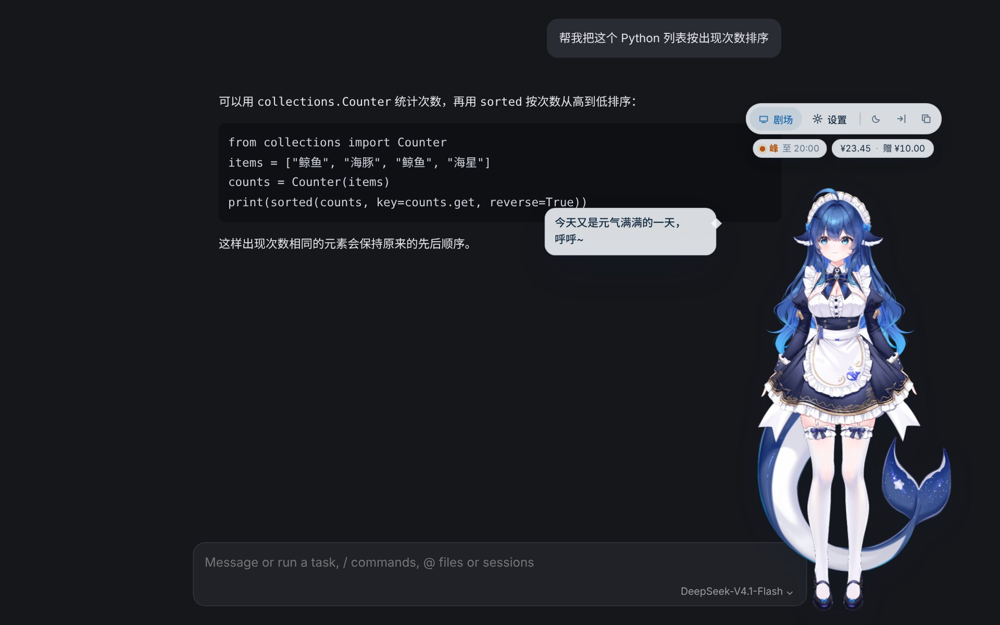

<table>
  <tr>
    <td width="50%">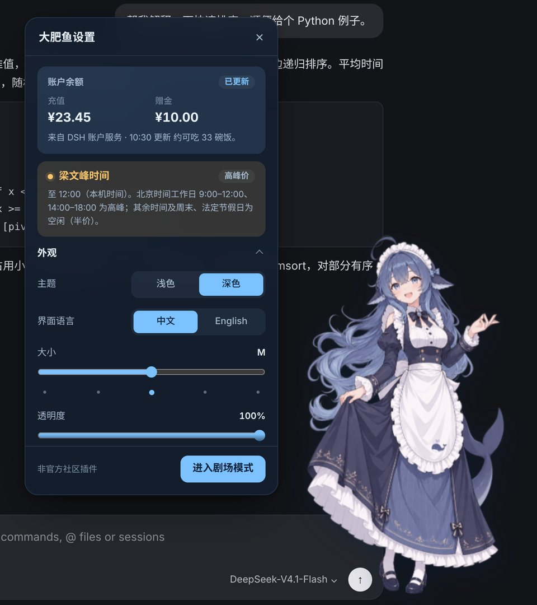</td>
    <td width="50%">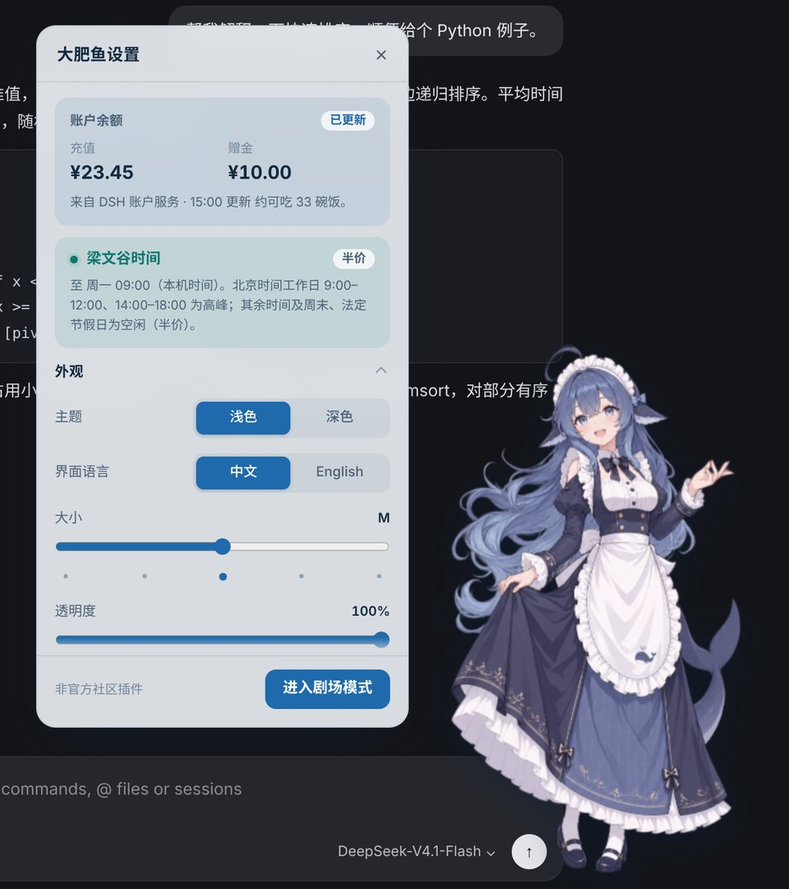</td>
  </tr>
  <tr>
    <td>设置面板贴在她身旁，不会挡住她：余额卡片、计费时段，以及到几点结束。<br>Settings sit beside her, never on top: balance, pricing period and when it ends.</td>
    <td>浅色主题，周末全天梁文谷（半价）。主题只影响插件本身。<br>Light theme; weekends are off-peak all day. Themes affect only the companion.</td>
  </tr>
</table>

**GalGame 对话剧场：** 点击输入框即可进入。全屏场景、居中的立绘、深蓝毛玻璃对话框和名字标签；她的表情会随每一页台词变化，头顶冒出情绪符号；文字逐字淡入，可以快进，代码有专门的卡片。<br>
**Visual-novel theatre:** click the chat box to enter. A full-screen scene, a centred portrait and a deep-blue glass dialogue box with a name tag; her expression changes with each page, with a mood mark above her head; text fades in character by character, with Skip, and code gets copyable cards.

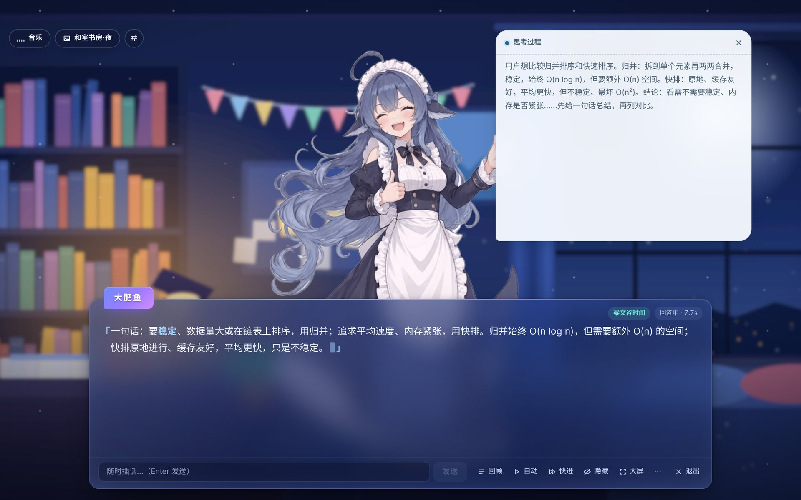

**四套背景，也能用你自己的图：** 和室书房·夜、科技机房、午后咖啡厅、海边黄昏，默认跟随时间切换，切换时 0.7 秒交叉淡入；也可以保留「透明」显示 DSH。<br>
**Four backgrounds, or your own picture:** a study at night, a server room, an afternoon café and a seaside dusk, following the time of day by default, with a 0.7 s crossfade; “Transparent” keeps DSH visible.

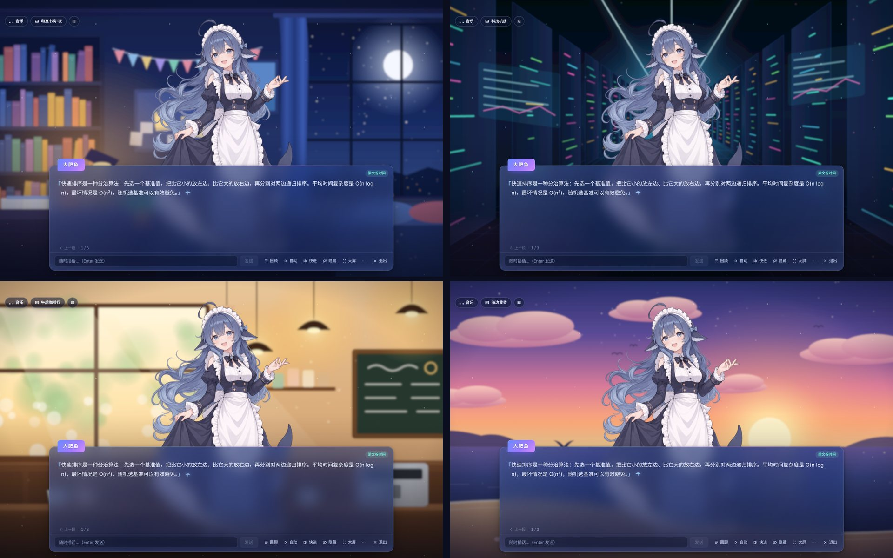

**背景音乐与背景切换：** 左上角的小按钮打开音乐、背景和剧场设置。三首内置曲目「日常轻快 / 宁静闲聊 / 深夜治愈」由插件实时演奏、无缝循环，也可以添加本地音乐；音量和选择会自动记住。<br>
**Music and backgrounds:** the chips at the top left open music, backgrounds and theatre settings. Three built-in tracks (Everyday Breeze, Quiet Chat, Late-night Comfort) are performed live and loop seamlessly, or add your own file; volume and choices are remembered.

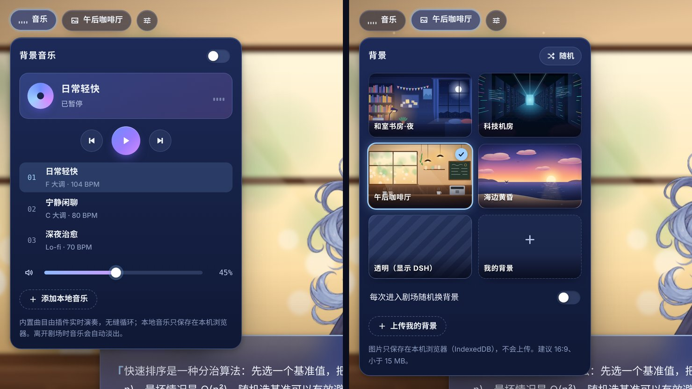

**六个新表情：** 得意、害羞、抓狂、惊讶、满足、开心，剧场和日常互动都会用到。<br>
**Six new expressions:** smug, shy, frustrated, surprised, proud and happy, used in the theatre and in everyday moments.

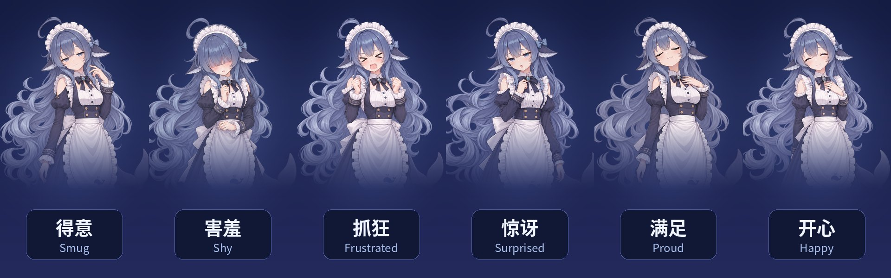

<table>
  <tr>
    <td width="33%">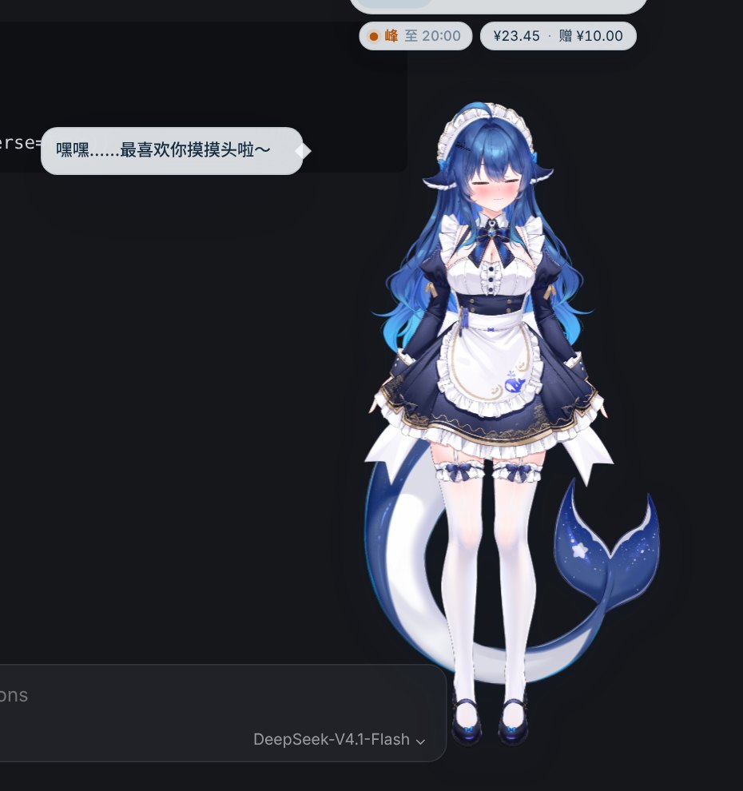</td>
    <td width="33%">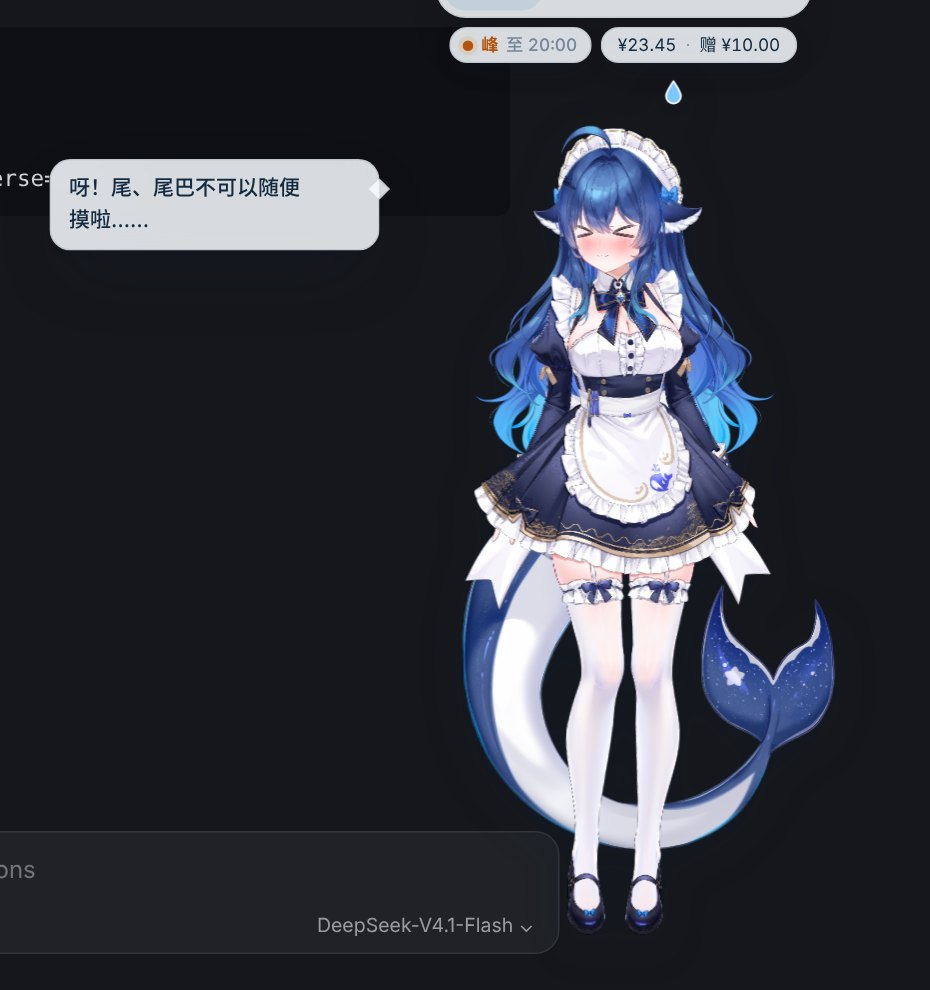</td>
    <td width="33%">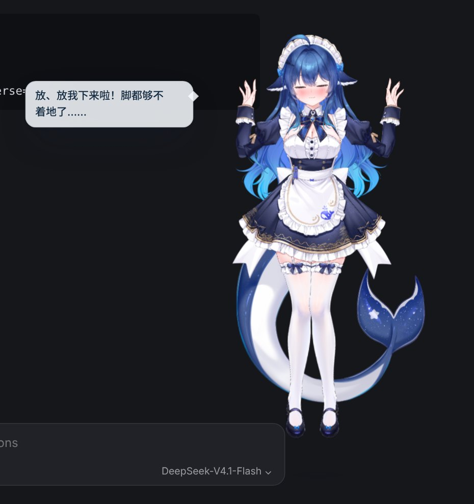</td>
  </tr>
  <tr>
    <td>在她头上来回移动鼠标：摸摸头，她会一脸满足或害羞，并叫出你设置的称呼。<br>Move the pointer over her head for a head pat; she looks content or shy and uses the name you set.</td>
    <td>Live2D：在尾巴上来回摸，她会害羞地躲开；一直摸会生气。<br>Live2D: stroke her tail and she blushes and dodges; keep at it and she gets cross.</td>
    <td>拖动她就被拎起来：先扑腾，再垂下来跟着手摆，松手落地。拖着快速晃会头晕；一直戳她是小彩蛋。<br>Dragging picks her up: she struggles, then dangles and swings; let go and she lands. Shake her and she gets dizzy; keep poking her for an easter egg.</td>
  </tr>
</table>

<details>
<summary>代码卡片与回答结束后的干饭时间 / Code card and rice break after the answer</summary>

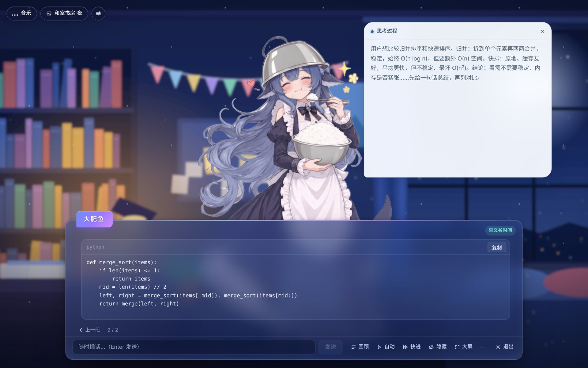

</details>

<sub>截图使用模拟的 DSH 页面和演示余额，插件界面是真实的 v0.7.0 代码；人物为可选导入的 DeepSeek-chan（大肥鱼）Live2D 模型（原画及拆分 [神宫凉子](https://space.bilibili.com/13737731)，Live2D 建模 霓虹猫_NeonNeko），模型不随插件提供。表情、场景与代码页截图来自 v0.6.0 的插图模式。 / Screenshots use a simulated DSH page and sample balance; the plugin UI is the actual v0.7.0 build. The character is the optionally imported DeepSeek-chan (大肥鱼) Live2D model (art and parts by [神宫凉子](https://space.bilibili.com/13737731), rigging by 霓虹猫_NeonNeko), which is not included with the plugin. The expression, scene and code-page screenshots come from v0.6.0 with illustrations.</sub>

<a id="english"></a>
## English

**Unofficial community plugin. Not affiliated with or endorsed by DeepSeek.**

An interactive desktop/web companion and visual-novel (GalGame) conversation theatre for the official [DeepSeek Harness (DSH)](https://github.com/deepseek-ai/deepseek-harness). 大肥鱼 lives inside DSH, reacts to reasoning and answers, and keeps you company while you work.

The product name is **大肥鱼** in both languages; `dsh-whale-pet` remains the repository and package identifier.

### New in v0.7.0

- **Optional Live2D model.** Import the free DeepSeek-chan (大肥鱼) model once (see [below](#live2d-model-optional)); the model's own physics moves her head, body, hair and skirt. Her eyes follow the pointer first, then her head, then her body. The original illustrations stay the default and the fallback.
- **She keeps herself busy.** Small idle moments (shifting her weight, stretching, glancing around) and, after a quiet while, longer performances, including the author's own idle animation for the model, playing with the foxtail, dozing off and humming. Moving the pointer stops them.
- **More touch.** Head pats, a sensitive tail that makes her shy and dodge, a hand on her chest when touched there, and picking her up: she struggles, dangles and swings behind your hand, then lands. Head pats, tail and pokes work in the theatre too.
- **Native gestures** from the model: hand on her chest after an answer, a raised finger for an idea, the foxtail when smug.
- **Safer Windows installer** for paths with Chinese or special characters, with backups and a targeted uninstall. See the [v0.7.0 release notes](docs/releases/v0.7.0.md).

### New in v0.6.0

- **Swaying clothes.** Her skirt, hair ends and tail sway gently through WebGL; her face is never distorted. Settings › Companionship › Swaying clothes turns it off. (With the optional Live2D model imported, the model's own physics moves her instead.)
- **Six new expressions** that follow the dialogue page by page, with a little hop and a mood mark (♥ ✦ ♪ 💧 ! ? 💢); also used for head pats, finished answers, announcements, idle moments and a poke easter egg.
- **Visual-novel touches:** characters fade in one by one, a whale-tail click-wait mark, and backgrounds that follow the time of day.
- The bundle is now about 7.6 MB (was 18.9 MB), and the theatre chips sit below the DSH title bar.

- **Scenes.** Four illustrated backgrounds (study at night, server room, afternoon café, seaside dusk), your own picture, or Transparent to keep DSH visible. Switching crossfades in 0.7 s without flashing; optionally pick a random one on every visit.
- **Background music.** Everyday Breeze, Quiet Chat and Late-night Comfort, performed live by the plugin with seamless loops, or your own audio file. Play/pause, previous/next, a smooth volume slider; music fades out when you leave the theatre or hide the page.
- **A proper visual-novel stage.** Larger centred portrait with a soft entrance, breathing and light pooled at her feet; a deep-blue glass dialogue box with a name tag; Skip (or hold Ctrl) races to the last page.
- **Remembered.** Background, music on/off, track and volume are saved; your picture and music stay in this browser (IndexedDB) and come back next time.

Full notes: [v0.7.0](docs/releases/v0.7.0.md).

### v0.5.2 Hotfix

- Settings retain a readable height when switching between windowed and maximized views.
- Strolls cover the available DSH viewport, wait a random 8–20 seconds, and only occasionally end with a rice break.
- Contributions require review and testing; releases require the creator’s approval. AI artwork must match the character and have clear provenance and permissions.

### v0.5.1 hotfix

- Wandering now travels visibly from the current position with the intended slow transition.

- Composer attachment, permission and model buttons no longer trigger theatre mode. Only clicking the text editor opens it automatically.
- Leaving theatre restores the companion at its saved position without sliding across the screen.

### New in v0.5.0

- **Balance at a glance.** On compatible hosts with the account service, when you are signed in to a DeepSeek account, your balance appears above her head and in Settings without opening DSH's account page. It refreshes every minute and after each answer. The plugin never touches credentials.
- **梁文峰 / 梁文谷 time.** A chip shows the current DeepSeek API pricing period and when it ends. She tells you “现在是梁文峰时间！” (peak) or “现在是梁文谷时间！” (off-peak, half price) when DSH opens and whenever it switches.
- **Settings never cover her.** The panel stays beside the character, slides to the other side at screen edges and becomes a separate panel in very narrow windows.
- **Consistent portraits.** All poses share one head size and foot line; 撒娇 no longer looks smaller.
- **Your name in her lines**, a smoother drag, a new soft character voice, a regrouped theatre and rebuilt light/dark themes.

Eighteen illustrations are embedded: five random thinking poses, inspiration, answering, 撒娇, dizzy, rice breaks, and the six v0.6.0 expressions. Reasoning has its own scrollable bubble; she uses the answering pose while output streams and eats rice afterwards. Chibi form switching is paused for now (its artwork is kept).

### Install or upgrade

Old installers in v0.1.0–v0.6.0 may fail on Windows. Prefer the latest full package or use the separate installer repair package beside an existing `lib` folder. See [installation recovery](docs/INSTALLATION_RECOVERY.md).

1. Download **dsh-whale-pet-v0.7.0.zip** from [Releases](https://github.com/Ewigkeit1203/dsh-whale-pet/releases).
2. Extract the entire archive into a permanent folder, such as `D:\dsh-whale-pet`.
3. Run `install.bat`, then open DSH or press **Ctrl + R** in its window.
4. Upgrade in the same folder, or rerun the installer if you moved the plugin. Keep the extracted files in place.

DSH supplies React and Cordis. End users do not need Node.js, npm or extra assets. All images are embedded in the browser bundle. Windows one-click scripts target the desktop profile; a compatible DSH host configuration can also load the web client.

For manual configuration, append the following to `~/.dsh/profiles/desktop/cordis.patch.yml`, replacing the example path:

```yaml
- insert:
    - id: dsh-whale-pet
      name: "file:///D:/dsh-whale-pet/lib/index.js"
```

Run `uninstall.bat` and refresh DSH to remove the plugin from the profile. Saved local preferences are retained.

### Controls

- **Hover** for quick actions: Theatre, Settings, Quiet mode, Dock to the edge and, after an answer with code, Copy code.
- Her skirt, hair ends and tail sway gently; turn this off in Settings › Companionship › Swaying clothes.
- **Click** her to open Settings; **drag** to move her. With Settings open, she and the panel move together.
- **Chips above her head:** the pricing period (click to hear it again) and your balance (click for details).
- Move the pointer back and forth over her head for a head pat. With the Live2D model, stroking her tail makes her shy, and dragging picks her up. Shaking her quickly makes her dizzy. Easter egg: keep poking her and see what happens.
- Click the DSH chat box to enter the **theatre**; press Escape or **Exit** to leave. Head pats, tail touches and pokes work there too (clicking her is a poke and does not turn the page). Click the text (or the scene) once to finish revealing it, again for the next page; with Transparent selected, clicking the background leaves. The bar under the text has Log, Auto, Skip, Hide, Expand and the ⋯ menu (sounds, reading mode, theme, language).
- **Theatre chips (top left):** music (tracks, play/pause, volume, your own file), background (time of day, four scenes, Transparent, your picture, shuffle) and theatre settings (text speed, size, typewriter, auto, sounds).
- Shortcuts: hold **Alt** to click through her, **Alt+W** hides or shows her, **Alt+T** toggles the theatre. In the theatre: ←/→, Enter, hold **Ctrl** to skip, **L** log, **A** auto, **H** hide, **M** sound, **Esc** closes menus first.
- Keyboard: Tab to her and press Enter to open Settings.

### Live2D model (optional)

大肥鱼 can use the free **DeepSeek-chan (大肥鱼) Live2D model** by 神宫凉子 (art and parts) and 霓虹猫_NeonNeko (Live2D rigging). The model's terms do not allow redistributing its files, so it is **not included**: download it from the author's page ([get the model](https://gf.bilibili.com/item/detail/1109618072?noTitleBar=1&from=mall-up_itemDetail&msource=cps_comments_13737731_cont-1-117527753588880&track_id=__BGMT__)), extract it, then open Settings › Character model › Import the model folder and pick the folder that contains `大肥鱼.model3.json`. The files stay in this DSH environment on this device; normal plugin upgrades preserve the imported model. Clearing app data or changing machines may require importing again. Live2D is optional and the runtime is already included in the plugin. Turn the switch off at any time to see the original illustrations again. Please credit the model's creators when you share content made with it.

### Compatibility and privacy

Preferences stay in local storage. A theatre picture or music file you add is kept in this browser's IndexedDB and never uploaded; Remove deletes it. Chat history is never stored or sent to any extra service; Log only reads messages already loaded on the page. Completion notifications are off by default and ask for system permission only when you turn them on. Doctor counts page selectors locally and copies no message content. Changing the interface language does not translate questions or answers.

**Balance:** read through DSH's own account service, the same one its account card uses. It needs a signed-in DeepSeek account; with an API key only, DSH has no balance to show. On DSH versions without that service, opening DSH's account settings still lets her read it from the page. Unread values show as —, and values that have not refreshed recently are marked “not live”. “Bowls left” and low-balance hints use fresh CNY data only.

**Pricing period:** follows [DeepSeek's official rule](https://api-docs.deepseek.com/zh-cn/quick_start/pricing/). Peak is Beijing time, weekdays 09:00–12:00 and 14:00–18:00; other hours, weekends and Chinese public holidays are off-peak at half price. The holiday table covers 2026 and is updated yearly.

**Swaying clothes:** only the skirt, hair ends and tail are deformed with WebGL; the face and upper body stay exactly as drawn. Without WebGL, if the context is lost, or with reduced motion, the still image is shown.

Response detection depends on DSH's page structure. Token speed appears only when DSH exposes it; character counts are never shown as tokens/s. Code blocks and lists get dedicated formatting, but this is not a full Markdown renderer. Expressions change by switching artwork; there is no lip-sync.

### Development

Use Node.js 22.18+ or 24+ for the TypeScript test runner. Install dependencies with `npm install` or `pnpm install`, then run:

```sh
npm run build
npm run typecheck
npm test
node --check lib/client.js
```

The build compiles the views, state, host adapter, CSS and all 12 PNGs into `lib/client.js` for DSH's `__ModuleLoader__`. Edit the source and rebuild; do not edit `lib/client.js` by hand. Current automated suite: **94 tests**.

### Contributors and acknowledgements

- **[Ewigkeit1203](https://github.com/Ewigkeit1203)** — creator, character concept, product direction and acceptance testing.
- **[神宫凉子](https://space.bilibili.com/13737731)** — art and parts of the free DeepSeek-chan (大肥鱼) Live2D model; **霓虹猫_NeonNeko** — its Live2D rigging, physics and animations. The model is not part of this project and is not redistributed here.
- **Antigravity (Google DeepMind)** — AI-assisted architecture and initial implementation.
- **GPT 6.1sol / Codex (OpenAI)** — AI backend engineering and technical design.
- **Gemini 4 Argon (Google)** — AI product management and product direction.
- **Claude Opus 5.5 (Anthropic)** — AI frontend engineering and interface implementation.

See the [contribution guide](CONTRIBUTING.md) for PR review, release approval and AI-art requirements. Contributions and reports are welcome through [Issues](https://github.com/Ewigkeit1203/dsh-whale-pet/issues) and pull requests. Include your DSH version and reproduction steps; omit private conversations and credentials.

### License

[MIT](LICENSE) for code. See [artwork permissions](ASSETS_LICENSE.md) and [contribution rules](CONTRIBUTING.md). The embedded Live2D Cubism Core and Framework have their own licenses; see [third-party notices](docs/THIRD_PARTY_NOTICES.md).

[Back to top](#top) | [中文说明](#chinese)

---

<a id="chinese"></a>
## 中文说明

**非官方社区插件，与 DeepSeek 官方无隶属或背书关系。**

大肥鱼是专为官方 [DeepSeek Harness (DSH)](https://github.com/deepseek-ai/deepseek-harness) 开发的桌宠与 GalGame 对话剧场。她生活在 DSH 界面内，会随着思考与回答切换动作，陪你一起工作。

中英文统一使用产品名 **大肥鱼**；仓库与包标识继续使用 `dsh-whale-pet`。

### v0.7.0 新体验

- **可选 Live2D 模型。** 导入一次免费的 DeepSeek-chan（大肥鱼）模型（见[下文](#live2d-模型可选)），头、身体、头发和裙摆由模型自带的物理驱动；看鼠标时眼睛先到、头随后、身体再跟。原版插图仍是默认和降级显示。
- **她会自己找事做。** 平时有换重心、伸懒腰、东张西望等小动作；安静一阵后会演一段更长的，包括模型作者做的待机动画、摆弄狗尾草、打瞌睡、哼歌。一动鼠标就停下。
- **更多触摸互动。** 摸头；尾巴很敏感，摸了会害羞地躲开；碰胸口会用手护住；拖动就把她拎起来，先扑腾、再垂下来跟着手摆，松手落地。剧场里也能摸头、摸尾巴和戳她。
- **模型原生手势**：回答完抚胸、灵光一闪竖手指、得意时拿出狗尾草。
- **更安全的 Windows 安装器**：支持中文和特殊字符路径，修改前备份，只卸载本插件。详见 [v0.7.0 发布说明](docs/releases/v0.7.0.md)。

### v0.6.0 新体验

- **裙摆飘动。** 裙摆、发梢和尾巴用 WebGL 轻轻摆动，脸部不会变形；可在 设置 › 陪伴 › 裙摆飘动 中关闭。（导入可选的 Live2D 模型后，改由模型自带的物理驱动。）
- **六个新表情**，剧场里逐页跟随台词变化，小跳一下并冒出情绪符号（♥ ✦ ♪ 💧 ! ? 💢）；摸头、回答完成、峰谷播报、闲置时以及戳戳彩蛋里也会用到。
- **GalGame 细节：** 文字逐字淡入、鲸尾点击提示，背景跟随时间切换。
- 运行包缩小到约 7.6 MB（原 18.9 MB）；剧场按钮移到 DSH 标题栏下方。

- **场景。** 四套插画背景（和室书房·夜、科技机房、午后咖啡厅、海边黄昏）、你自己的图片，或者「透明」继续显示 DSH。切换时 0.7 秒交叉淡入，不闪白；可以设为每次进入随机换一张。
- **背景音乐。** 「日常轻快」「宁静闲聊」「深夜治愈」由插件实时演奏、无缝循环，也可以添加本地音乐。播放/暂停、上一首/下一首、平滑音量条；离开剧场或页面隐藏时自动淡出。
- **真正的 GalGame 舞台。** 立绘更大、居中，带淡入、呼吸和脚下的场景光；深蓝毛玻璃对话框配名字标签；「快进」（或按住 Ctrl）直接跳到最后一段。
- **自动记住。** 背景、音乐开关、曲目和音量都会保存；你的图片和音乐只保存在本机浏览器（IndexedDB），下次打开自动恢复。

完整说明见 [v0.7.0 发布说明](docs/releases/v0.7.0.md)。

### v0.5.2 快速更新

- 设置在窗口与全屏间保持可读高度，内容内部滚动。
- 散步目的地覆盖 DSH 可用区域，每次随机等待 8～20 秒，结束后仅偶尔吃饭。
- 完善贡献审查及发布确认流程；接受形象统一、来源及授权清楚的 AI 美术。

### v0.5.1 快速修复

- 散步恢复真实位移，按当前位置选择路线，并使用慢速过渡。

- 添加文件、权限及模型按钮不再误触剧场；仅点击文字输入区自动进入。
- 退出剧场直接在保存的位置恢复桌宠，消除横穿屏幕的滑动。

### v0.5.0 新体验

- **余额一眼可见。** 在 DSH 中登录 DeepSeek 账号后，余额会显示在她头顶和设置里，不用再打开 DSH 账户页；每分钟和每次回答结束后自动刷新。插件不接触任何凭据。
- **梁文峰 / 梁文谷时间。** 小标签显示当前 DeepSeek API 计费时段和结束时间。打开 DSH 时和每次切换时，她会告诉你“现在是梁文峰时间！”（高峰）或“现在是梁文谷时间！”（空闲，半价）。
- **设置面板不再挡住她。** 面板始终贴在角色旁边，到屏幕边缘会平滑换到另一侧，窗口太窄时改为独立面板。
- **立绘大小一致。** 所有姿态的头部大小和脚底位置统一，撒娇不再显小。
- **台词使用你的称呼**；另外拖动更流畅，人物音效更柔和，剧场重新整理，明暗主题重新设计。

内嵌 18 张插画：五套随机思考姿态、顿悟、回答、撒娇、眩晕、干饭，以及 v0.6.0 的六个新表情。推理过程显示在独立的可滚动气泡里；输出期间用回答姿态，输出结束后吃饭。Q 版切换暂时关闭，素材保留。

### 安装或升级

旧版 v0.1.0–v0.6.0 的安装脚本在 Windows 上可能失败。建议更新完整插件；需要保留旧功能时可使用单独的安装器修复包。详见[安装问题与旧版本修复](docs/INSTALLATION_RECOVERY.md)。

1. 从 [Releases](https://github.com/Ewigkeit1203/dsh-whale-pet/releases) 下载 **dsh-whale-pet-v0.7.0.zip**。
2. 完整解压到固定文件夹，例如 `D:\dsh-whale-pet`。
3. 双击 `install.bat`，再打开 DSH，或在已打开的窗口中按 **Ctrl + R** 刷新。
4. 升级时覆盖同一目录中的插件文件；若换了目录，请重新运行安装脚本。解压后的文件需要保留。

React 与 Cordis 由 DSH 提供，普通用户无需 Node.js、npm 或额外素材。所有角色图片都内嵌在运行包中。Windows 一键脚本适配 desktop 配置；兼容的 DSH 宿主配置也可加载网页客户端。

手动安装时，可在 `~/.dsh/profiles/desktop/cordis.patch.yml` 追加以下内容，替换为实际路径：

```yaml
- insert:
    - id: dsh-whale-pet
      name: "file:///D:/dsh-whale-pet/lib/index.js"
```

卸载时运行 `uninstall.bat` 并刷新 DSH。已保存的本地偏好会保留。

### 怎么操作

- **悬停**出现快捷操作：剧场、设置、安静模式、贴边；最近的回答里有代码时，还会出现“复制代码”。
- 她的裙摆、发梢和尾巴会轻轻飘动；可在 设置 › 陪伴 › 裙摆飘动 中关闭。
- **点击**她打开设置，**拖动**可以移动她。设置打开时，她和面板会一起移动。
- **头顶小标签**：计费时段（点击再播报一次）和余额（点击查看详情）。
- 在她头上来回移动鼠标可以摸头；使用 Live2D 模型时，摸尾巴她会害羞，拖动会把她拎起来。快速晃动她会头晕。小彩蛋：一直戳她试试看。
- 点击 DSH 聊天输入框进入**剧场**；按 Escape 或「退出」离开。剧场里也能摸头、摸尾巴和戳她（点她算戳，不会翻页）。第一次点击文字（或场景）会显示完当前段，再点一次翻页；选择「透明」背景时，点击背景会退出。文字下方的按钮栏有回顾、自动、快进、隐藏、大屏和“⋯”菜单（音效、阅读方式、主题、语言）。
- **剧场左上角小按钮**：音乐（曲目、播放/暂停、音量、本地音乐）、背景（跟随时间、四套场景、透明、我的背景、随机）和剧场设置（文字速度、字号、打字机、自动翻页、音效）。
- 快捷键：按住 **Alt** 可点穿她，**Alt+W** 隐藏或显示她，**Alt+T** 开关剧场。剧场里：←/→、Enter，按住 **Ctrl** 快进，**L** 回顾，**A** 自动，**H** 隐藏界面，**M** 音效，**Esc** 先关闭菜单。
- 键盘：用 Tab 聚焦到她，按 Enter 打开设置。

### Live2D 模型（可选）

大肥鱼可以使用免费的 **DeepSeek-chan（大肥鱼）Live2D 模型**（原画及拆分：神宫凉子；Live2D 建模：霓虹猫_NeonNeko）。模型使用须知不允许重新分发模型文件，所以插件**不附带模型**：请从作者的发布页下载（[获取页面](https://gf.bilibili.com/item/detail/1109618072?noTitleBar=1&from=mall-up_itemDetail&msource=cps_comments_13737731_cont-1-117527753588880&track_id=__BGMT__)），完整解压后，打开 设置 › 角色模型 › 导入模型文件夹，选择含有 `大肥鱼.model3.json` 的文件夹。文件保存在当前 DSH 的本机存储中，正常升级插件会保留已导入的模型；清理应用数据、换电脑或换存储环境后可能需要重新导入。Live2D 是可选项，运行库已包含在插件中。随时可以关闭开关，回到原版插图。使用模型公开发布内容时，请按作者要求注明模型来源和制作人员。

### 兼容性与隐私

偏好只保存在本地。你添加的剧场图片和音乐只保存在本机浏览器的 IndexedDB 中，不会上传，点「移除」即可删除。聊天记录不会被保存，也不会发送给任何额外服务；“回顾”只读取页面上已加载的消息。完成通知默认关闭，只有你主动开启时才会申请系统权限。Doctor 只在本地统计页面选择器数量，不复制消息内容。切换界面语言不会翻译提问或回答。

**余额**：通过 DSH 自带账户卡片使用的同一个账户服务读取，需要登录 DeepSeek 账号；只使用 API Key 时 DSH 没有余额可显示。在没有该服务的 DSH 版本上，打开 DSH 账户设置后她仍能从页面读取。未读取显示 —，一段时间没刷新的数据会标注“非实时”。“还能吃几碗”和低余额提醒只使用最新的人民币数据。

**计费时段**：按 DeepSeek 官方规则。北京时间工作日 9:00–12:00、14:00–18:00 为高峰，其余时间以及周末、法定节假日为空闲时段，价格减半。节假日表目前覆盖 2026 年，每年更新。

**裙摆飘动**：只有裙摆、发梢和尾巴由 WebGL 形变，脸和上半身保持原画不变。不支持 WebGL、上下文丢失或开启减弱动效时显示静态立绘。

回答识别依赖 DSH 页面结构。只在 DSH 提供时显示 token 速度，不会用字符数冒充 tokens/s。代码块和列表有专门排版，但不是完整的 Markdown 渲染器。表情靠切换立绘实现，没有真实口型。

### 本地开发

运行 TypeScript 测试建议使用 Node.js 22.18+ 或 24+。通过 `npm install` 或 `pnpm install` 安装开发依赖，然后执行：

```sh
npm run build
npm run typecheck
npm test
node --check lib/client.js
```

构建会把界面、状态机、宿主适配器、CSS 和 12 张 PNG 编入 DSH `__ModuleLoader__` 使用的 `lib/client.js`。请修改源码后重新构建，不要手动编辑 `lib/client.js`。当前共有 **94 项自动测试**。

### 贡献者与致谢

- **[Ewigkeit1203](https://github.com/Ewigkeit1203)**：项目发起人、人设原案、产品方向与体验验收。
- **[神宫凉子](https://space.bilibili.com/13737731)**：免费 DeepSeek-chan（大肥鱼）Live2D 模型的原画及拆分；**霓虹猫_NeonNeko**：该模型的 Live2D 建模、物理与动作。模型不属于本项目，本仓库不重新分发模型文件。
- **Antigravity (Google DeepMind)**：AI 辅助架构设计与初期实现。
- **GPT 6.1sol / Codex (OpenAI)**：AI 后端工程与技术设计。
- **Gemini 4 Argon (Google)**：AI 产品管理与产品方向。
- **Claude Opus 5.5（Anthropic）**：AI 前端工程与界面实现。

欢迎阅读[贡献指南](CONTRIBUTING.md)：代码经 PR 审查与测试后才可合并，发布须由项目负责人确认；接受形象统一、来源与授权清楚的 AI 美术。

欢迎通过 [Issues](https://github.com/Ewigkeit1203/dsh-whale-pet/issues) 和 Pull Request 反馈问题或贡献代码。请提供 DSH 版本和复现步骤，避免上传私人对话与账户凭据。

### 开源许可证

代码采用 [MIT License](LICENSE)。美术权限见[授权说明](ASSETS_LICENSE.md)，投稿见[贡献指南](CONTRIBUTING.md)。内嵌的 Live2D Cubism Core 与 Framework 适用各自的许可，见[第三方声明](docs/THIRD_PARTY_NOTICES.md)。

[返回顶部](#top) | [English](#english)
